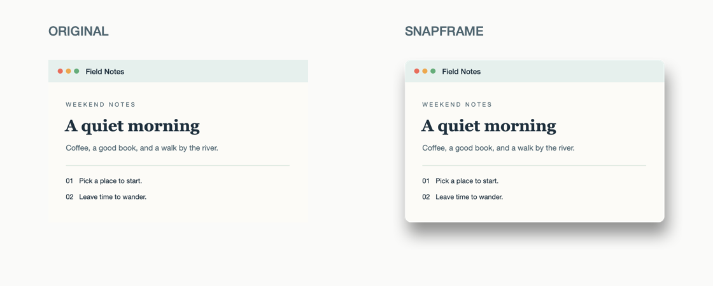

# SnapFrame

把任意区域截图变成有窗口感的图片。选中 PNG 或 JPEG，在 Finder 里右键运行 SnapFrame，就能得到带圆角、右下柔影和透明留白的 PNG。

*A native macOS Finder Quick Action for adding rounded corners and directional shadows to screenshots.*



## 从源码开始

需要 **macOS 14 或更新版本**和带 Swift 6 工具链的完整 Xcode。首发版本提供源码，本地构建后即可试用。

```sh
git clone https://github.com/ctri-y/SnapFrame.git
cd SnapFrame
./Scripts/build.sh
open .build/SnapFrame.app
```

也可以打开 `SnapFrame.xcodeproj`，在 Xcode 里运行 **SnapFrame** scheme。构建脚本把 Finder 扩展一起打包到 `.build/SnapFrame.app`，日志在 `.build/BuildLogs`。本次用 Xcode 27.2 在 Apple silicon 和 macOS 26.6.2 上验证了 Finder 流程。最低部署目标为 macOS 14，并生成 arm64 和 x86_64 构建，macOS 14 和 Intel 的实际运行仍待验证。

## 在 Finder 使用

1. 首次打开 SnapFrame 后，在 Finder 里选一张 PNG 或 JPEG。
2. 右键选择 **快速操作 → SnapFrame**。如果列表里找不到 SnapFrame，打开 **快速操作 → 自定（Customize）**，在 Finder 扩展里启用它。
3. 在原图旁边找到 `原文件名 SnapFrame.png`。如果同名文件已存在，新文件会自动加序号。

你也可以先按 **⇧⌘4** 框选想分享的区域，再处理保存下来的截图。截图范围由 macOS 自带工具选定，SnapFrame 给保存后的图片加效果。[Apple 截图快捷键](https://support.apple.com/zh-cn/102646)

- 一次可处理 **1–16 张 PNG/JPEG**。单张失败时，其余成功项可以保留。
- 输出为透明 **sRGB PNG**。原图的像素尺寸保留，画布四周各加 140 px 留白。
- 原图保留，处理全程在本机完成。Finder 流程无需登录账号或授予录屏权限。
- 部分分享平台会把透明区域显示为白底。PNG 文件本身保留透明通道。

## 开发与验证

```sh
./Scripts/check-processing.sh
```

检查覆盖圆角、右下投影、透明边缘、PNG 回读、原图保护和 16 张批处理。导入与拖放另有 `./Scripts/check.sh`。App 与 Finder 扩展共用 Swift 图像处理核心，使用系统的 Core Graphics 和 ImageIO。

本地构建采用临时签名，当前试用方式为从源码构建。面向直接下载安装的分发版需要 Developer ID 签名及公证。[Apple 分发说明](https://developer.apple.com/documentation/security/notarizing-macos-software-before-distribution)
